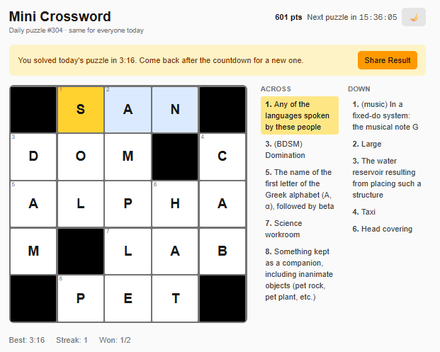
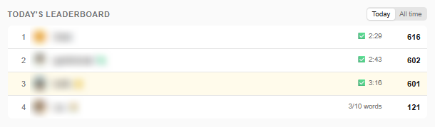
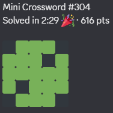

# Mini Crossword

A daily 5×5 crossword. Everyone gets the same puzzle each UTC day: it is generated deterministically from the date (see `lib/generator.ts`).

 

## Scoring

Rules live in `lib/scoring.ts`. The browser uses them for instant feedback and the server uses them for the leaderboard.

| | Points |
|---|---|
| Each correct word | 10 × length + rare-letter bonus (D G 1 · B C M P 2 · F H V W Y 3 · K 4 · J X 6 · Q Z 8) |
| Completing without Reveal | +100 |
| Time bonus (on completion) | 200 × (1 − time / 10 min), minimum 0 |
| Check letter / Check word | −5 per wrong letter it flags; correct letters turn green and lock |
| Reveal | Keeps words already earned; no completion or time bonus |

The server re-scores every submission. A solve's time is the slower of the time the client reports and the play time the server measures from request heartbeats (see `PlayTime` in `src/platform/server/games.ts`), so editing the client's clock doesn't help.

Players can post their result to a channel with **Share Result**. The share grid is green for words solved, and yellow for any the player revealed. On the leaderboard, a revealed game shows 🔎 and doesn't count as solved.

## Layout

| Path | What's there |
|---|---|
| `meta.ts` | Name, emoji and `PUZZLE_VERSION`, as listed in the game registry |
| `components/` | The game UI: `Crossword` (state, sync, input), grid, clue list, win modal |
| `lib/` | Generator, word bank, scoring, share text, local progress, server sync (`reconcile.ts`, `api.ts`) |
| `server/game.ts` | The game's API (`sync`, `progress`, `check`, `reveal`), served at `/api/games/crossword` |
| `scripts/` | Word-bank maintenance; never run at build or runtime |

## Changing the word bank or generator

Any change to `lib/wordbank*.ts`, `lib/patterns.ts` or `lib/generator.ts` changes the puzzle that a given date produces. When you change any of them, bump `PUZZLE_VERSION` in `meta.ts`. Saved progress and leaderboards are keyed by version, so players get a clean reset instead of a mismatched grid. Ideally deploy such changes near 00:00 UTC.

To refresh the generated part of the word bank from Datamuse, run `bun src/games/crossword/scripts/fetch-clues.ts` from the repo root. `scripts/sort-wordbank.mjs` re-sorts both word lists in place.
